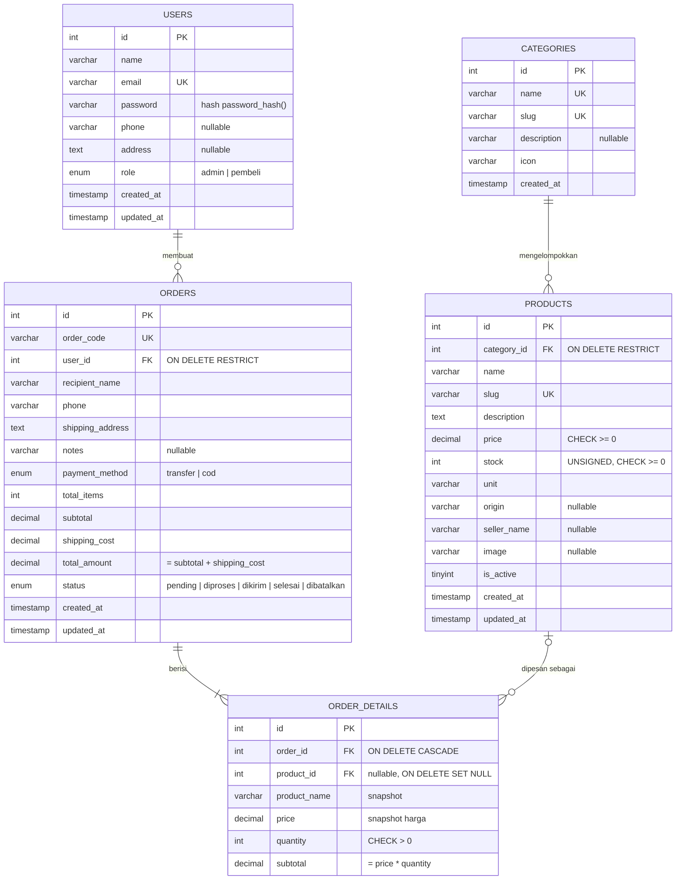

# 3. Entity Relationship Diagram (ERD)

Diagram berikut ditulis dalam format **Mermaid** dan sesuai dengan struktur pada `database/pasarkita.sql`. Dapat dirender langsung di GitHub, VS Code (ekstensi Markdown Preview Mermaid), atau https://mermaid.live.

## Keterangan Notasi

| Simbol | Arti |
|---|---|
| `\|\|--o{` | satu ke nol-atau-banyak |
| `\|\|--\|{` | satu ke satu-atau-banyak (pesanan minimal punya 1 item) |
| `\|o--o{` | nol-atau-satu ke nol-atau-banyak (`product_id` boleh NULL bila produk dihapus) |
| PK / FK / UK | Primary Key / Foreign Key / Unique Key |
