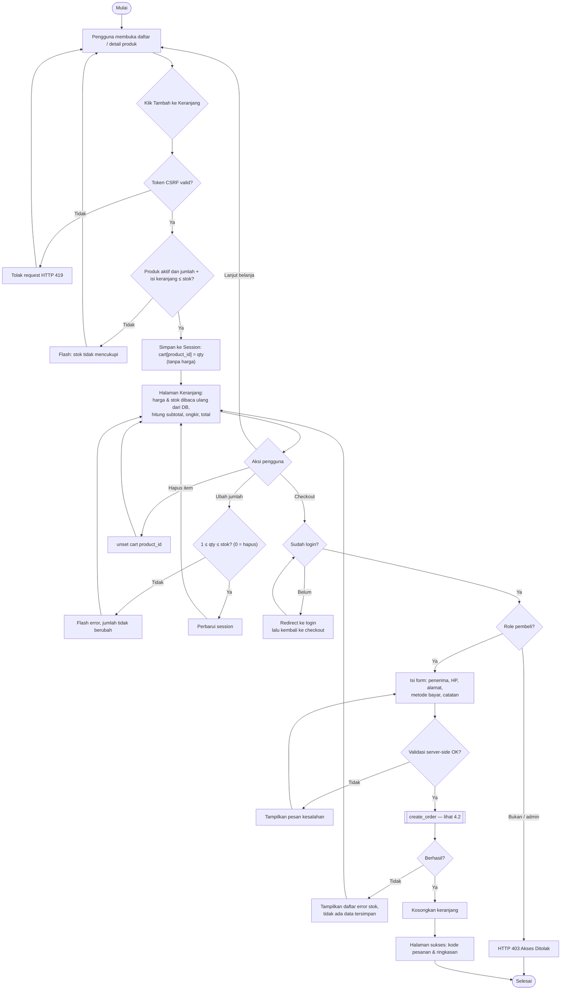
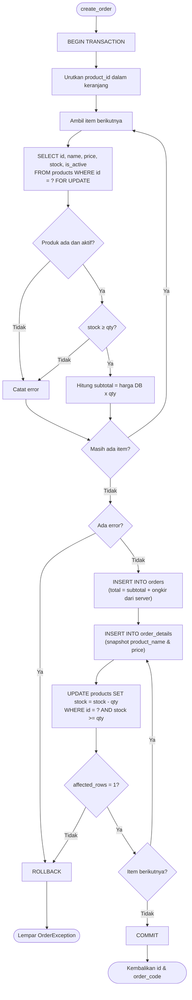
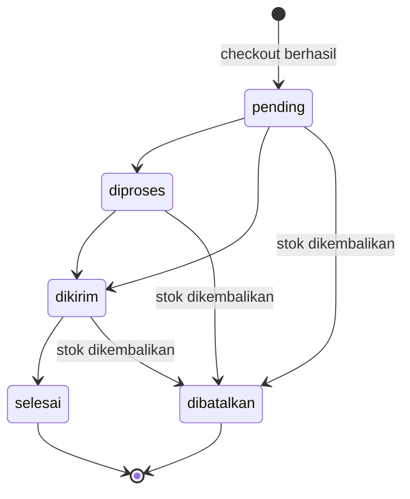

# 4. Flowchart Proses Transaksi

Flowchart ini menggambarkan alur aktual pada `cart/*.php`, `checkout/index.php`, dan fungsi `create_order()` di `includes/order.php`.

## 4.1 Alur Belanja hingga Checkout

## 4.2 Detail `create_order()` — Database Transaction

## 4.3 Alur Status Pesanan (Admin)

Diagram di atas menunjukkan alur normal. Secara teknis admin dapat memilih status apa pun di antara `pending`, `diproses`, `dikirim`, `selesai`, `dibatalkan` selama status saat ini **belum final**; setelah `selesai` atau `dibatalkan`, status tidak dapat diubah lagi.

Perubahan ke `dibatalkan` juga dijalankan dalam satu transaksi (`update_order_status()`): status diperbarui dan stok setiap produk yang masih ada dikembalikan sekaligus.
