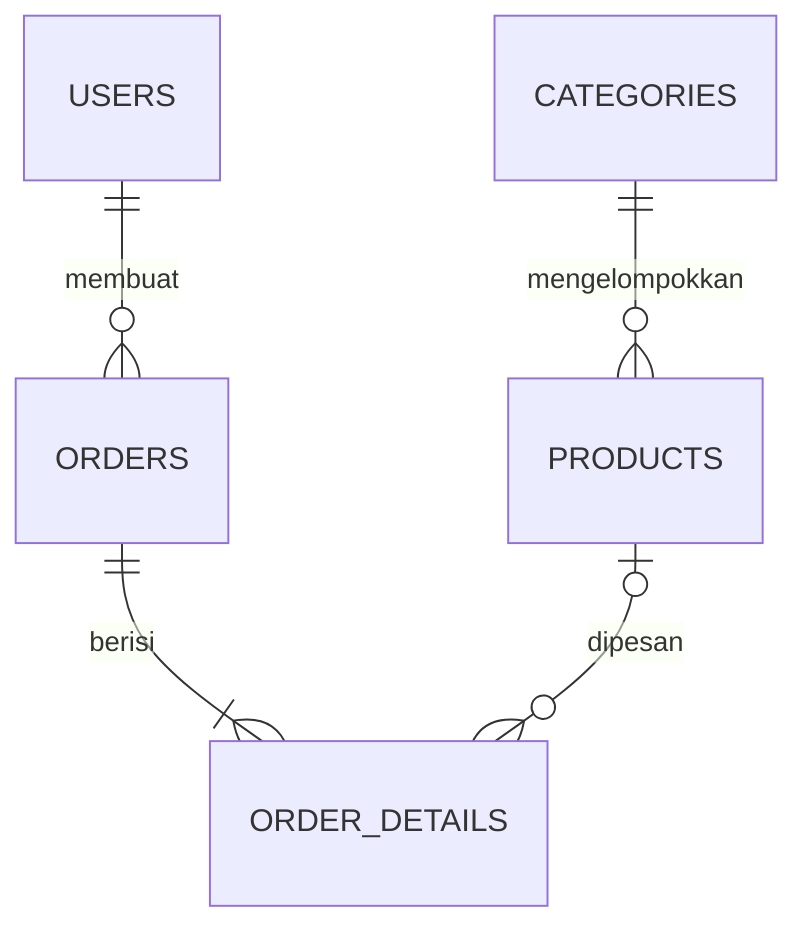
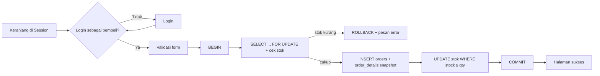

# LAPORAN AKHIR UJIAN PRAKTIKUM
## Pembangunan Web Marketplace Tradisional "PasarKita"

| | |
|---|---|
| Nama | *(isi nama)* |
| NIM | *(isi NIM)* |
| Kelas / Mata Kuliah | *(isi)* |
| Dosen / Asisten | *(isi)* |
| Repository GitHub | *(isi URL setelah dipublikasikan)* |
| URL Aplikasi (InfinityFree) | *(isi URL setelah deploy & diuji)* |

> Cara konversi ke PDF: `pandoc docs/10-laporan-akhir.md -o laporan-akhir.pdf` (butuh Pandoc + LaTeX), atau buka file ini di VS Code dengan ekstensi *Markdown PDF* lalu pilih *Export (pdf)*. Diagram Mermaid dapat diekspor sebagai gambar dari https://mermaid.live bila konverter tidak mendukung Mermaid.

---

## BAB I — Pendahuluan

### 1.1 Latar Belakang
Produk tradisional Indonesia seperti batik, tenun, kuliner khas, rempah, kerajinan, dan jamu umumnya diproduksi oleh UMKM dan pengrajin yang memiliki keterbatasan akses pasar. PasarKita dirancang sebagai marketplace sederhana yang mempertemukan penjual produk tradisional dengan pembeli secara daring, dengan informasi asal daerah dan nama penjual pada setiap produk.

### 1.2 Tujuan
1. Membangun aplikasi web marketplace menggunakan PHP Native, MySQL (MySQLi), dan Bootstrap 5.
2. Menerapkan autentikasi berbasis session dengan role admin dan pembeli.
3. Menerapkan proses transaksi yang konsisten menggunakan *database transaction* (commit/rollback), validasi stok, dan snapshot harga.
4. Menerapkan praktik keamanan dasar aplikasi web.
5. Menyiapkan aplikasi untuk dipublikasikan ke GitHub dan di-deploy ke InfinityFree.

### 1.3 Batasan
- Satu role pengelola (admin) mengelola seluruh katalog; penjual direpresentasikan sebagai atribut produk (`seller_name`, `origin`).
- Pembayaran tidak terintegrasi payment gateway; metode yang dicatat adalah Transfer Bank dan COD.
- Ongkos kirim bersifat flat (default Rp 10.000) dan dapat diubah di konfigurasi.

---

## BAB II — Analisis dan Perancangan

### 2.1 Teknologi
| Komponen | Teknologi |
|---|---|
| Backend | PHP Native (tanpa framework), kompatibel PHP 8.0+ (diuji 8.2 & 8.5) |
| Database | MySQL 8 / MariaDB 10.4+, akses melalui **MySQLi prepared statement** |
| Frontend | HTML5, CSS3, JavaScript (vanilla), **Bootstrap 5.3.3**, Bootstrap Icons |
| State | PHP Session (autentikasi & keranjang) |

### 2.2 Identifikasi Entitas
Lima entitas utama: `users`, `categories`, `products`, `orders`, `order_details`. Rincian aktor, atribut, relasi, dan aturan bisnis terdapat pada [01-identifikasi-entitas.md](01-identifikasi-entitas.md).

### 2.3 Rancangan Database
Struktur tabel, tipe data, primary key, foreign key, indeks, dan CHECK constraint dijelaskan pada [02-rancangan-database.md](02-rancangan-database.md). Poin penting:

- `products.stock` bertipe `INT UNSIGNED` dengan `CHECK (stock >= 0)` → stok tidak bisa negatif.
- `order_details.product_name` dan `order_details.price` menyimpan **snapshot** saat dipesan.
- `order_details.product_id` `ON DELETE SET NULL` → histori tetap ada saat produk dihapus.
- `orders.total_amount` dijaga `CHECK (total_amount = subtotal + shipping_cost)`.

### 2.4 ERD
Lihat diagram Mermaid pada [03-erd.md](03-erd.md).



### 2.5 Flowchart Transaksi
Flowchart lengkap (keranjang → checkout → `create_order()` → status pesanan) terdapat pada [04-flowchart-transaksi.md](04-flowchart-transaksi.md). Ringkasnya:



### 2.6 Rancangan Antarmuka
Mockup halaman daftar produk, detail produk, dan keranjang terdapat pada:
[05-mockup-daftar-produk.md](05-mockup-daftar-produk.md), [06-mockup-detail-produk.md](06-mockup-detail-produk.md), [07-mockup-keranjang.md](07-mockup-keranjang.md).

---

## BAB III — Implementasi

### 3.1 Struktur Project
```
PasarKita/
├── index.php, .htaccess, .gitignore, README.md
├── config/      config.example.php (+ config.php lokal, di-ignore)
├── database/    pasarkita.sql, pasarkita_hosting.sql
├── includes/    bootstrap, db, functions, auth, cart, order, product, layout
├── auth/        login, register, logout
├── products/    index (daftar/cari/filter), detail
├── cart/        index, add, update, remove
├── checkout/    index, success
├── account/     orders, order_detail
├── admin/       index (dashboard), products/*, orders/*
├── assets/      css, js, img
├── uploads/     products/ (gambar unggahan)
├── docs/        dokumentasi
└── tests/       run_tests.php
```

### 3.2 Fitur yang Diimplementasikan

**A. Halaman publik** — Beranda (hero, statistik, kategori, produk terbaru), daftar produk dengan pencarian, filter kategori, pengurutan & pagination, detail produk dengan produk serupa, keranjang, checkout, dan halaman keberhasilan pesanan.

**B. Autentikasi** — Registrasi (validasi nama, email unik, nomor HP, password minimal 8 karakter berisi huruf & angka), login dengan `password_verify()`, `password_hash()` saat registrasi, `session_regenerate_id(true)` setelah login, logout melalui POST + CSRF, pembatasan 5 kali percobaan login gagal per session.

**C. Manajemen produk (admin)** — Daftar produk dengan pencarian & filter, tambah, edit, hapus, upload gambar (JPG/PNG/WEBP, maks. 2 MB, dicek MIME asli dengan `finfo` dan `getimagesize`, nama file acak), kelola stok & harga, aktif/nonaktif, validasi seluruh input di server.

**D. Transaksi** — Keranjang di session hanya menyimpan `product_id => qty`; harga selalu dibaca dari database. Tambah, ubah jumlah, hapus item, kosongkan keranjang; subtotal, ongkir, dan total dihitung server. Checkout memakai `begin_transaction()`, `SELECT ... FOR UPDATE`, insert `orders` & `order_details` (snapshot), pengurangan stok bersyarat, lalu `commit()`/`rollback()`.

**E. Dashboard admin** — Statistik jumlah produk, pesanan, pendapatan, dan pembeli; transaksi terbaru; grafik batang produk per kategori; daftar stok menipis; daftar transaksi dengan filter status & pencarian; detail transaksi dengan perubahan status (pembatalan mengembalikan stok).

**Tambahan** — Halaman "Pesanan Saya" dan detail pesanan untuk pembeli (menampilkan harga saat dipesan dan harga sekarang).

### 3.3 Potongan Kode Penting

Prepared statement (`includes/db.php`):
```php
function db_query(string $sql, string $types = '', array $params = []): mysqli_stmt
{
    $stmt = db()->prepare($sql);
    if ($types !== '') {
        $stmt->bind_param($types, ...$params);
    }
    $stmt->execute();
    return $stmt;
}
```

Inti transaksi checkout (`includes/order.php`):
```php
$conn->begin_transaction();
try {
    // SELECT ... FOR UPDATE untuk setiap produk, validasi stok
    // INSERT INTO orders (...) — total dari harga database
    // INSERT INTO order_details (..., product_name, price, ...) — snapshot
    $affected = db_execute('UPDATE products SET stock = stock - ? WHERE id = ? AND stock >= ?', 'iii', [...]);
    if ($affected !== 1) { throw new OrderException([...]); }
    $conn->commit();
} catch (Throwable $e) {
    $conn->rollback();
    throw $e;
}
```

### 3.4 Penerapan Keamanan

| Ketentuan | Implementasi |
|---|---|
| Prepared statements MySQLi | Semua query bernilai dinamis melalui `db_query()`; nama kolom ORDER BY diambil dari whitelist |
| Validasi input server-side | Registrasi, login, produk, keranjang, checkout, status pesanan |
| Escape output HTML | Fungsi `e()` (`htmlspecialchars` ENT_QUOTES, UTF-8) di seluruh template |
| Proteksi halaman berdasarkan role | `require_login()`, `require_role()`, `require_admin()`; 403 untuk role yang salah |
| Validasi file upload | Cek error upload, ukuran ≤ 2 MB, MIME asli (`finfo`), ekstensi, `getimagesize`, nama acak; `.htaccess` di `uploads/` mematikan eksekusi skrip |
| Proteksi CSRF | Token 64 hex per session, `hash_equals`, pada semua form POST (keranjang, checkout, login, register, logout, CRUD, status) |
| Session regeneration | `session_regenerate_id(true)` setelah login; cookie `HttpOnly`, `SameSite=Lax`, `Secure` bila HTTPS, `use_strict_mode` |
| Pencegahan manipulasi harga | Harga & total dihitung ulang dari database; field harga dari browser diabaikan (terbukti di pengujian) |
| Password database tidak di repository | `config/config.php` di-`.gitignore`; hanya `config.example.php` tanpa kredensial yang di-commit |
| Lainnya | Open-redirect dicegah (`safe_redirect_path`), header keamanan, `.htaccess` memblokir folder `config/`, `includes/`, `database/`, `docs/`, `tests/`, dan file `.sql`/`.md`; error detail hanya tampil bila `debug = true` |

---

## BAB IV — Pengujian

Pengujian otomatis end-to-end (`tests/run_tests.php`) mengirim request HTTP sungguhan ke aplikasi dan memverifikasi database. Hasil pada 16 November 2026: **92/92 lulus** di PHP 8.5.8 dan **92/92 lulus** di PHP 8.2.33 dengan MySQL 8.4.3.

| Fitur | Hasil |
|---|---|
| Koneksi database & constraint | Lulus |
| Registrasi dan login | Lulus |
| CRUD produk + upload gambar | Lulus |
| Daftar produk, pencarian, filter | Lulus |
| Detail produk | Lulus |
| Tambah ke keranjang | Lulus |
| Ubah kuantitas | Lulus |
| Hapus dari keranjang | Lulus |
| Checkout | Lulus |
| Penyimpanan orders | Lulus |
| Penyimpanan order_details (snapshot) | Lulus |
| Pengurangan stok | Lulus |
| Validasi stok tidak mencukupi + rollback | Lulus |
| Akses admin dan pembeli | Lulus |

Rincian skenario, error yang ditemukan beserta perbaikannya, dan output lengkap ada di [09-pengujian.md](09-pengujian.md).

*(Tambahkan tangkapan layar aplikasi di sini sebelum dikonversi ke PDF: beranda, daftar produk, detail, keranjang, checkout, halaman sukses, dashboard admin, form produk.)*

---

## BAB V — Deployment

- Panduan instalasi lokal: [08-instalasi.md](08-instalasi.md)
- Panduan GitHub, konfigurasi database hosting, upload, import database, dan verifikasi di InfinityFree: [11-deployment-infinityfree.md](11-deployment-infinityfree.md)

Status saat laporan ini disusun: kode siap dipublikasikan dan di-deploy; **publikasi GitHub dan deploy InfinityFree belum dilakukan** dan harus dikerjakan oleh pemilik akun. URL di halaman judul diisi setelah aplikasi benar-benar dapat diakses dan diuji.

---

## BAB VI — Penutup

### 6.1 Kesimpulan
1. Aplikasi PasarKita berhasil dibangun dengan PHP Native, MySQLi, dan Bootstrap 5 dengan struktur modular.
2. Seluruh fitur wajib (halaman publik, autentikasi, manajemen produk, transaksi, dashboard) berjalan dan lulus 92 skenario pengujian otomatis.
3. Konsistensi transaksi dijamin oleh *database transaction*, penguncian baris, pengurangan stok bersyarat, CHECK constraint, dan snapshot harga.
4. Praktik keamanan yang diminta (prepared statement, escape output, CSRF, role, validasi upload, regenerasi session, anti-manipulasi harga, kredensial di luar repository) telah diterapkan.

### 6.2 Saran Pengembangan
1. Role penjual terpisah agar setiap UMKM mengelola produknya sendiri.
2. Integrasi payment gateway dan perhitungan ongkir berdasarkan ekspedisi.
3. Manajemen kategori dan profil pengguna dari antarmuka admin.
4. Fitur ulasan & rating produk.
5. Bootstrap disertakan secara lokal agar aplikasi tetap tampil tanpa koneksi CDN.

---

## Lampiran
- A. Kode sumber lengkap: repository GitHub *(isi URL)*
- B. File database: `database/pasarkita.sql`
- C. Output pengujian: `docs/09-pengujian.md` bagian 9.7
