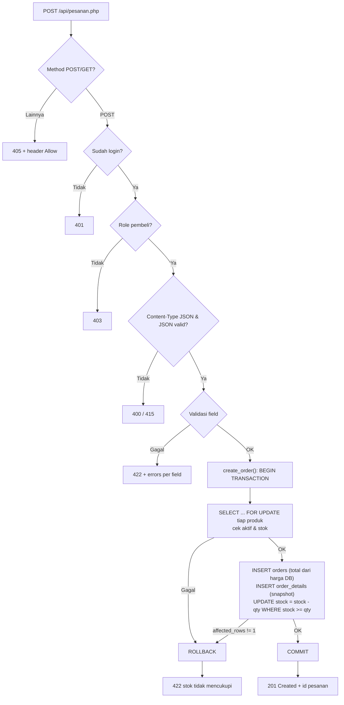

# SOAL 12 — Rancangan REST API PasarKita

## 1. Web Service dan REST API

**Web service** adalah layanan yang dapat dipanggil aplikasi lain melalui jaringan (HTTP) menggunakan format data yang disepakati, sehingga dua sistem yang berbeda bahasa/platform dapat bertukar data tanpa saling mengetahui detail implementasinya.

**REST API** (*Representational State Transfer Application Programming Interface*) adalah gaya web service yang:

| Prinsip | Penerapan di PasarKita |
|---|---|
| Resource diakses lewat URL | `/api/produk.php`, `/api/kategori.php`, `/api/pesanan.php` |
| Operasi memakai HTTP method | `GET` membaca data, `POST` membuat data, `DELETE` logout |
| Representasi data standar | JSON (`Content-Type: application/json; charset=utf-8`) |
| Status dinyatakan dengan HTTP status code | 200, 201, 400, 401, 403, 404, 405, 415, 422, 429, 500 |
| Stateless per request | Setiap request membawa semua informasi yang diperlukan; identitas pembeli dibawa lewat cookie session |

## 2. Mengapa Marketplace Membutuhkan API

1. **Banyak jenis klien** — aplikasi Android/iOS, aplikasi kasir, atau situs mitra dapat menampilkan katalog PasarKita tanpa menyalin database.
2. **Satu sumber data** — web dan API membaca tabel yang sama, sehingga harga dan stok selalu konsisten.
3. **Integrasi pihak ketiga** — jasa pengiriman, payment gateway, atau marketplace agregator berkomunikasi lewat JSON.
4. **Pemisahan tampilan dan logika** — tim frontend dapat mengembangkan antarmuka baru tanpa mengubah logika transaksi di server.
5. **Keamanan transaksi terpusat** — validasi stok, perhitungan total, dan transaction database tetap dijalankan di server, tidak di klien.

## 3. Rancangan Endpoint

Base URL lokal (XAMPP): `http://localhost/pasarkita`

| No | Method | Endpoint | Fungsi | Auth | Status sukses | Status gagal |
|---|---|---|---|---|---|---|
| 1 | GET | `/api/produk.php` | Daftar produk aktif + nama kategori. Parameter opsional: `q`, `kategori`, `urut`, `halaman`, `limit` | Tidak | 200 | 400, 404 (kategori), 405 |
| 2 | GET | `/api/produk.php?id={id}` | Detail produk | Tidak | 200 | 400, 404, 405 |
| 3 | GET | `/api/kategori.php` | Seluruh kategori + jumlah produk aktif (`?id=` untuk satu kategori) | Tidak | 200 | 400, 404, 405 |
| 4 | POST | `/api/pesanan.php` | Membuat pesanan (transaction) | Pembeli | 201 | 400, 401, 403, 415, 422, 405 |
| 5 | GET | `/api/pesanan.php` | Pesanan milik pengguna yang login (`?id=` untuk detail) | Ya | 200 | 400, 401, 404 |
| 6 | POST | `/api/auth.php` | Login (email & password) | — | 200 | 401, 415, 422, 429 |
| 7 | GET | `/api/auth.php` | Pengguna yang sedang login | Ya | 200 | 401 |
| 8 | DELETE | `/api/auth.php` | Logout | — | 200 | — |
| 9 | GET | `/api/` | Informasi API & daftar endpoint | Tidak | 200 | 405 |

Endpoint 1–4 adalah endpoint wajib SOAL 12; endpoint 5–9 adalah pendukung (verifikasi pesanan dan autentikasi).

### Parameter daftar produk

| Parameter | Contoh | Keterangan |
|---|---|---|
| `q` | `kopi` | Cari di nama, deskripsi, asal daerah (maks. 100 karakter) |
| `kategori` | `batik-tenun` atau `1` | Slug atau ID kategori; 404 bila tidak ada |
| `urut` | `terbaru` (default), `harga_asc`, `harga_desc`, `nama` | Urutan data |
| `halaman` | `1` | Nomor halaman |
| `limit` | `20` (default, maks. 100) | Jumlah data per halaman |

## 4. Format Response Standar

Semua response memiliki tiga kunci utama, ditambah `meta` (daftar data) atau `errors` (rincian validasi) bila relevan.

```json
{ "success": true,  "message": "Data berhasil diambil", "data": [] }
{ "success": false, "message": "Produk tidak ditemukan", "data": null }
{ "success": false, "message": "Data pesanan tidak valid.", "data": null,
  "errors": { "telepon": "Nomor telepon tidak valid. Contoh: 081234567890." } }
```

| Kode | Arti | Contoh pemakaian |
|---|---|---|
| 200 OK | Berhasil | GET produk, login |
| 201 Created | Data baru dibuat | POST pesanan berhasil (+ header `Location`) |
| 400 Bad Request | Request rusak | JSON tidak valid, body kosong, parameter `id` bukan angka |
| 401 Unauthorized | Belum login / login gagal | POST pesanan tanpa login |
| 403 Forbidden | Login, tetapi tidak berhak | Admin mencoba membuat pesanan |
| 404 Not Found | Data tidak ada | Produk/kategori/pesanan tidak ditemukan |
| 405 Method Not Allowed | Method salah (+ header `Allow`) | `PUT /api/pesanan.php` |
| 415 Unsupported Media Type | Body bukan JSON | POST dengan `Content-Type: application/x-www-form-urlencoded` |
| 422 Unprocessable Entity | JSON benar tetapi isinya tidak dapat diproses | Field wajib kosong, stok tidak mencukupi |
| 429 Too Many Requests | 5x login gagal | Tunggu 60 detik |
| 500 Internal Server Error | Kesalahan server | Database mati: `"Tidak dapat terhubung ke database."` (tanpa detail teknis) |

## 5. Struktur JSON Daftar Produk

`GET /api/produk.php?kategori=batik-tenun&limit=2`. Untuk menyingkat, hanya satu item ditampilkan sebagai contoh struktur; urutan data asli mengikuti parameter `urut`:

```json
{
  "success": true,
  "message": "Data produk berhasil diambil",
  "data": [
    {
      "id": 1,
      "nama": "Batik Tulis Motif Kawung",
      "slug": "batik-tulis-motif-kawung",
      "harga": 350000,
      "stok": 11,
      "satuan": "lembar",
      "tersedia": true,
      "asal_daerah": "Yogyakarta",
      "penjual": "Sanggar Batik Kawung",
      "gambar_url": "http://localhost/pasarkita/assets/img/products/batik-kawung.svg",
      "kategori": { "id": 1, "nama": "Batik & Tenun", "slug": "batik-tenun" }
    }
  ],
  "meta": {
    "total": 4, "halaman": 1, "limit": 2, "total_halaman": 2,
    "filter": { "q": "", "kategori": "batik-tenun", "urut": "terbaru" }
  }
}
```

| Field | Tipe | Sumber kolom |
|---|---|---|
| id | integer | `products.id` |
| nama, slug | string | `products.name`, `products.slug` |
| harga | number | `products.price` (DECIMAL → angka) |
| stok | integer | `products.stock` |
| satuan | string | `products.unit` |
| tersedia | boolean | `stock > 0` |
| asal_daerah, penjual | string/null | `products.origin`, `products.seller_name` |
| gambar_url | string | URL absolut dari `products.image` (placeholder bila kosong) |
| kategori.id / nama / slug | object | JOIN `categories` |

## 6. Struktur JSON Detail Produk

Sama dengan daftar produk, ditambah `deskripsi`, `url_halaman` (tautan halaman web), `dibuat_pada`, dan `diperbarui_pada`.

```json
{
  "success": true,
  "message": "Detail produk berhasil diambil",
  "data": {
    "id": 1,
    "nama": "Batik Tulis Motif Kawung",
    "slug": "batik-tulis-motif-kawung",
    "harga": 350000,
    "stok": 11,
    "satuan": "lembar",
    "tersedia": true,
    "asal_daerah": "Yogyakarta",
    "penjual": "Sanggar Batik Kawung",
    "gambar_url": "http://localhost/pasarkita/assets/img/products/batik-kawung.svg",
    "kategori": { "id": 1, "nama": "Batik & Tenun", "slug": "batik-tenun" },
    "deskripsi": "Kain batik tulis halus bermotif kawung klasik, ...",
    "url_halaman": "http://localhost/pasarkita/products/detail.php?slug=batik-tulis-motif-kawung",
    "dibuat_pada": "2026-11-01 09:00:00",
    "diperbarui_pada": "2026-11-16 13:31:49"
  }
}
```

Produk nonaktif (`is_active = 0`) diperlakukan sama dengan tidak ada → **404**.

## 7. Struktur JSON Kategori

```json
{
  "success": true,
  "message": "Data kategori berhasil diambil",
  "data": [
    { "id": 1, "nama": "Batik & Tenun", "slug": "batik-tenun",
      "deskripsi": "...", "ikon": "bi-palette", "jumlah_produk": 4 }
  ],
  "meta": { "total": 5 }
}
```

## 8. Struktur JSON Pesanan

**Request** `POST /api/pesanan.php` (header `Content-Type: application/json`, sudah login sebagai pembeli):

```json
{
  "produk": [
    { "produk_id": 7, "jumlah": 2 },
    { "produk_id": 1, "jumlah": 1 }
  ],
  "nama_penerima": "Siti Pembeli",
  "telepon": "081234567890",
  "alamat_pengiriman": "Jl. Merdeka No. 10, Bandung, Jawa Barat 40111",
  "catatan": "Opsional",
  "metode_pembayaran": "transfer"
}
```

| Field | Wajib | Aturan (sama dengan checkout web) |
|---|---|---|
| produk | Ya | Array 1–50 item; `produk_id` bilangan bulat positif; `jumlah` 1–1000. Produk yang sama digabung |
| nama_penerima | Tidak* | 3–100 karakter |
| telepon | Tidak* | Pola `^(\+62\|62\|0)[0-9]{8,13}$` |
| alamat_pengiriman | Tidak* | 10–500 karakter |
| catatan | Tidak | Maks. 255 karakter |
| metode_pembayaran | Tidak | `transfer` (default) atau `cod` |

\* Bila tidak dikirim, diisi dari profil akun yang login (seperti formulir checkout web yang terisi otomatis), lalu tetap divalidasi.

Field seperti `harga`, `subtotal`, atau `total` dari klien **diabaikan**. Server menghitung semuanya dari database.

**Response 201** berisi `id` pesanan, `kode_pesanan`, ringkasan biaya, dan `items` (snapshot nama & harga). Contoh lengkap ada di [pengujian-api.md](pengujian-api.md).

## 9. Autentikasi & Identitas Pembeli

API **tidak** menerima `user_id` dari klien. Identitas pembeli diambil dari session login yang sama dengan aplikasi web SOAL 11:

1. Klien mengirim `POST /api/auth.php` berisi email dan password akun yang sudah ada di tabel `users`. Password diverifikasi dengan `password_verify()`.
2. Server menjalankan `login_user()`, fungsi yang sama dengan login web. Fungsi ini memanggil `session_regenerate_id(true)` dan mengirim cookie `PASARKITASESSID` (HttpOnly, SameSite=Lax).
3. Postman menyimpan cookie tersebut, sehingga `POST /api/pesanan.php` berikutnya memakai `$_SESSION['user_id']` sebagai `orders.user_id`.
4. Hanya role `pembeli` yang boleh membuat pesanan (admin → 403), sama seperti checkout web.

Perlindungan terhadap request lintas situs (CSRF) pada endpoint POST/DELETE:

- Body wajib `Content-Type: application/json` (415 jika bukan). Form HTML biasa tidak dapat mengirim tipe ini.
- Cookie memakai `SameSite=Lax`.
- API tidak mengirim header CORS, sehingga browser situs lain tidak bisa membuat request JSON yang membawa cookie.

## 10. Alur POST Pesanan



## 11. Struktur File

```
api/
├── index.php            GET  info API
├── produk.php           GET  daftar & detail produk
├── kategori.php         GET  daftar & detail kategori
├── pesanan.php          POST buat pesanan, GET pesanan saya
├── auth.php             POST login, GET me, DELETE logout
└── helpers/             (diblokir dari browser oleh .htaccess)
    ├── bootstrap.php    memuat config + koneksi + auth + order milik SOAL 11, handler error JSON
    ├── response.php     api_success(), api_error(), api_json_body(), api_allow_methods()
    ├── format.php       pemetaan baris database -> JSON
    └── .htaccess        Require all denied
```

Tidak ada file `api/config/database.php` terpisah. API memakai ulang `config/config.php` dan `includes/db.php`, sehingga koneksi database tidak diduplikasi dan kredensial hanya tersimpan di satu file yang tidak di-commit.
